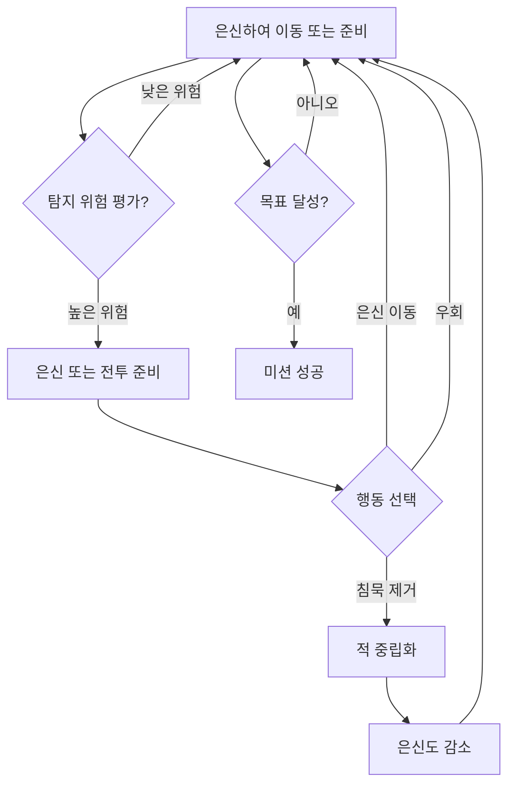

# Modern Military Stealth - 게임 디자인 문서

| 항목 | 내용 |
|---|---|
| 문서 유형 | GDD |
| 상태 | Draft |
| 버전 | 0.1 |
| 최종 수정 | 2026-10-12 |
| 작성자 | 크리에이티브 디렉터 |
| 관련 이슈 | REFAA-5 |
| 관련 문서 | [UI/UX 기획서](../ui/ui-ux.md) |

## 1. 한 줄 정의
현대 군사 스텔스 액션 + 적의 시선을 피해 목표를 달성하는 긴장감 + 실시간 탐지 시스템과 Procedural 긴장도

## 2. 전제 조건
- 엔진: Godot 4.7.2 (GDScript)
- 플랫폼: Windows PC (1920x1080 기준)
- 타겟: 스텔스 게임 애호가, 전술적 사고를 즐기는 플레이어
- 개발 인원/기간: 1인 개발, 3개월 (버티컬 슬라이스 기준)
- 가정: 
  - 적 AI는 시야와 청각을 기반으로 탐지
  - 플레이어는 은신도 게이지로 자신의 노출 수준을 인지
  - 레벨은 여러 경로와 은신처를 제공하는 구조

## 3. 필러 (3~4개)
| 필러 | 의미 | 이 필러를 깨는 예 |
|---|---|---|
| 긴장감 조절 | 플레이어의 스트레스 수준을 탐지 위험과 은신도 게임플레이로 조절 | 은신도 없이 단순히 적을 쏘는 액션 게임 |
| 전술적 자유 | 여러 경로와 도구로 목표 달성의 다양한 방법 제공 | 일직선 레벨과 정해진 해결책만 있는 게임 |
| 현실감 있는 현대 군비 | 실제 현대 군 장비와 기술을 기반으로 한 장비 및 능력 | 판타지 또는 미래 무기만 등장하는 게임 |
| 프로시저얼 긴장도 | 적의 배치와 경비가 매 플레이마다 약간씩 변하여 기억에 의존하지 않는 플레이 요구 | 완전히 동일한 적 배치와 경비 패턴만 반복 |

각 기능은 아래 정합성 표에서 필러에 연결한다.

## 4. 코어 루프

초/분/시간 단위 루프:
- 초 단위: 은신도 게이지 업데이트, 적 시야/청각 체크, 플레이어 입력 처리
- 분 단위: 적 경비 루틴 변화, 은신도 회복률 조절
- 시간 단위: 미션 전체 흐름 (잠입 -> 목표 달성 -> 탈출)

## 5. 플레이어 판타지와 감정
| 판타지 | 감정 | 느끼게 하는 장치 |
|---|---|---|
| 현대 특수부대 요원 | 긴장감과 성취감 | 은신도 게이지, 적의 반응적 탐지, 성공적인 침묵 제거 |
| 전술적 계획자 | 만족감과 창의성 | 여러 경로, 장비 선택, 환경 상호작용 |
| 그림자 같은 존재 | puissance과 통제감 | 적을 전혀 알리지 않고 이동, 환경 소음 활용 |

## 6. 시스템 구성
| 시스템 | 한 줄 역할 | 필러 | 기획서 링크 | 상태 |
|---|---|---|---|---|
| 은신도 시스템 | 플레이어의 노출 수준을 수치로 관리 | 긴장감 조절 | [은신도 시스템](./systems/stealth-system.md) | Draft |
| 탐지 시스템 | 적의 시야와 청각을 통해 플레이어를 탐지 | 긴장감 조절, 현실감 | [탐지 시스템](./systems/detection-system.md) | Draft |
| 장비 시스템 | 플레이어가 장착하고 사용할 장비 관리 | 현실감 있는 현대 군비 | [장비 시스템](./systems/equipment-system.md) | Draft |
| 레벨 시스템 | 레벨 로드, 목표 관리, 진행 상황 추적 | 전술적 자유 | [레벨 시스템](./systems/level-system.md) | Draft |
| AI 시스템 | 적의 행동 결정과 경비 루틴 | 현실감 있는 현대 군비, 프로시저얼 긴장도 | [AI 시스템](./systems/ai-system.md) | Draft |

## 7. 진행 구조
- 세션 길이: 15-30분 미션 (버티컬 슬라이스 기준)
- 해금 순서: 미션 완료 시 다음 미션 해금, 장비는 미션 내 획득 또는 사전 선택
- 난이도 곡선: 적 탐지 범위와 반응 속도 증가, 은신도 회복률 감소
- 종료 조건: 모든 목표 달성 및 추출 지점 도달 또는 플레이어 사망

## 8. 범위 밖 (안 하기로 한 것)
| 항목 | 이유 | 재검토 시점 |
|---|---|---|
| 멀티플레이어 협동 | 범위 초과 및 복잡성 증가 | 버티컬 슬라이스 완료 후 검토 |
| 차량 조종 | 스텔스 핵심 루프와 방향성 mismatch | 향후 확장팩 고려 |
| 스토리 중심 캠페인 | 버티컬 슬라이스에서는 게임플레이에 집중 | 미션 간 간단한 브리핑으로 대체 |
| 신체 부위별 데미지 | 구현 복잡성과 스텔스 루프와 geringe 관련성 | 추후 검토 |

## 9. 리스크
| 리스크 | 영향 | 완화 | 검증 시점 |
|---|---|---|---|
| 적 AI 탐지 로직 복잡성 | 구현 지연 및 버그 발생 | 점진적 구현 (시야 먼저, потом 청각) | 매주 테스트 |
| 은신도 게이지의 직관성 부족 | 플레이어 혼란 | 명확한 피드백 (시각적, 청각적) 및 튜토리얼 | 내부 플레이테스트 |
| 레벨 디자인의 여러 경로 균형 | 일부 경로가 지나치게 쉬움 또는 어려움 | 반복적 플레이테스트 및 데이터 수집 | 레벨 완성 후 |

## 10. 후속 문서 TODO
| ID | 필요한 문서/작업 | 왜 필요한가 | 담당 | 선행 조건 | 시급도 |
|---|---|---|---|---|---|
| T-01 | 은신도 시스템 기획서 | GDD 6절에서 참조 | 시스템 디자이너 | GDD 초안 완료 | 즉시 |
| T-02 | 탐지 시스템 기획서 | GDD 6절에서 참조 | 시스템 디자이너 | GDD 초안 완료 | 즉시 |
| T-03 | 장비 시스템 기획서 | GDD 6절에서 참조 | 시스템 디자이너 | GDD 초안 완료 | 즉시 |
| T-04 | 레벨 시스템 기획서 | GDD 6절에서 참조 | 시스템 디자이너 | GDD 초안 완료 | 즉시 |
| T-05 | AI 시스템 기획서 | GDD 6절에서 참조 | 시스템 디자이너 | GDD 초안 완료 | 즉시 |
| T-06 | 튜토리얼 및 온보딩 설계 | 신규 플레이어 진입 장벽 해소 | 내러티브/UI 디자이너 | 시스템 기획서 초안 | 다음 마일스톤 |
| T-07 | 사운드 디자인 계획 | 분위기 및 피드백 강화 | 오디오 디자이너 | 시스템 기획서 초안 | 다음 마일스톤 |