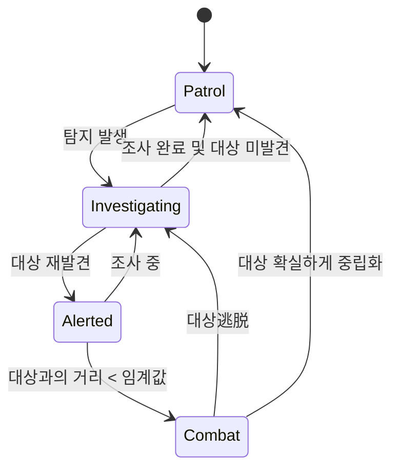

# 탐지 시스템 - 시스템 기획서

| 항목 | 내용 |
|---|---|
| 문서 유형 | 시스템 기획서 |
| 상태 | Draft |
| 버전 | 0.1 |
| 최종 수정 | 2026-10-12 |
| 작성자 | 크리에이티브 디렉터 |
| 관련 이슈 | REFAA-5 |
| 관련 문서 | [GDD](../gdd/modern-military-stealth.md), [은신도 시스템](./stealth-system.md) |

## 1. 이 시스템이 왜 필요한가
탐지 시스템은 적이 플레이어를 발견하는지를 판단하여 게임의 긴장감과 도전성을 제공한다. 이 시스템이 없으면 적은 항상 플레이어를 알거나 전혀 알 수 없어 스텔스 게임플레이가 불가능해진다. GDD의 필러 정합성 표에서 "긴장감 조절"과 "현실감 있는 현대 군비" 필러와 연결된다.

## 2. 전제 조건
- 은신도 시스템: 플레이어의 노출 수준을 제공해야 함
- 위치 시스템: 적과 플레이어의 위치를 알 수 있어야 함 (Transform 또는 유사한 방법)
- 환경 시스템: 시야를 가리는 장애물 정보 제공 (레이캐스트용)
- 청각 시스템: 소리 발생 및 전달 정보 제공 (선택적, 기본 구현에서는 간소화)

## 3. 규칙
1. 탐지는 시야 기반과 청각 기반 두 가지 방법으로 발생한다.
2. 시야 탐지: 
   - 적은 시야 각도 내에 있는 객체를 탐지할 수 있다.
   - 시야 각도는 120도이다.
   - 시야 거리 기본값은 15미터이다.
   - 은신도 수준에 따라 효과적 시야 거리가 조정된다: 효과적 거리 = 기본 거리 * (1.0 - 은신도 * 0.7)
   - 은신도 0.0일 때 효과적 거리 = 15m, 은신도 1.0일 때 효과적 거리 = 4.5m
   - 장애물 (벽 등)이 시야를 차단하면 탐지 실패이다.
3. 청각 탐지:
   - 적들은 일정 거리 이내의 소리를 탐지할 수 있다.
   - 청각 거리 기본값은 10미터이다.
   - 은신도 수준에 따라 효과적 청각 거리가 조정된다: 효과적 거리 = 기본 거리 * (1.0 - 은신도 * 0.5)
   - 은신도 0.0일 때 효과적 거리 = 10m, 은신도 1.0일 때 효과적 거리 = 5m
   - 소리 크기에 따라 청각 거리가 조정된다 (소리 크기 계수 적용).
4. 탐지 시 적은 경보 상태가 되고, 조사 행동을 시작한다.
5. 탐지 후 일정 시간 동안 은신도가 일정 수준 이하로 떨어져도 적은 마지막 알려진 위치를 조사한다.

## 4. 상태와 전이

상세 상태 전이는 AI 시스템에서 다룰 것이지만, 탐지 시스템은 Patrol 상태에서 Investigating 상태로의 전이를 담당한다.

## 5. 수치
| 이름 | 기본값 | 범위 | 튜닝 담당 | 근거 |
|---|---|---|---|---|
| 시야 각도 | 120° | 90°-150° | 시스템 디자이너 | 인간의 전방 시야 범위 기반 |
| 시야 거리 기본값 | 15.0 m | 10-25 m | 시스템 디자이너 | 일반적인 적의 시야 거리 |
| 청각 거리 기본값 | 10.0 m | 5-20 m | 시스템 디자이ner | 소리 전파 거리 |
| 은신도 시야 영향 계수 | 0.7 | 0.5-0.9 | 시스템 디자이너 | 은신도 1.0일 때 시야 거리를 30%로 감소 |
| 은신도 청각 영향 계수 | 0.5 | 0.3-0.7 | 시스템 디자이너 | 은신도 1.0일 때 청각 거리를 50%로 감소 |
| 조사 시간 | 10.0 s | 5-20 s | 시스템 디자이너 | 적이 장소를 조사하는 시간 |
| 경보 유지 시간 | 30.0 s | 15-60 s | 시스템 디자이너 | 탐지 후 경계 상태 유지 시간 |
| 전투 진입 거리 | 5.0 m | 3-8 m | 시스템 디자이너 | 적이 사격을 시작하는 거리 |

수식 예시:
- 효과적 시야 거리 = 시야 거리 기본값 * (1.0 - 은신도 * 은신도 시야 영향 계수)
- 효과적 청각 거리 = 청각 거리 기본값 * (1.0 - 은신도 * 은신도 청각 영향 계수)
- 소리 크기 계수: 발소리 0.5, 총소리 2.0, 폭발 3.0 (청각 거리에 곱함)

## 6. 엣지케이스와 실패 처리
| 상황 | 기대 동작 | 이유 |
|---|---|---|
| 동시 탐지 (시야 및 청각) | 탐지 발생 (하나만 충족해도 탐지) | 탐지 조건은 OR 관계 |
| 시야 차단 장애물 이동 | 레이캐스트를 매 프레임 수행하여 동기화 유지 | 움직이는 장애물에도 정확히 반응해야 함 |
| 소리 전달 지연 (선택적 구현) | 소리 발생 후 일정 지연 후 청각 탐지 가능 | 현실감 향상을 위한 선택적 기능 |
| 여러 적의 동시 탐지 | 각각 독립적으로 탐지 처리 | 적들은 독립적인 감각을 가짐 |
| 데이터 누락 (위치 정보 오류) | 해당 프레임 탐지 생략 및 로그 기록 | 오류가 게임 진행을 멈추지 않게 함 |
| 극단적 은신도 값 (0.0 또는 1.0) | 공식을 적용하여 효과적 거리 계산 | 수치적 안정성 필요 |

## 7. Godot 구현 연결
- 노드/씬 구성: 
  - 씬 파일 경로: `res://systems/detection/detection_system.tscn`
  - 루트 노드 타입: Node
  - 주요 자식 노드: 
    - DetectionManager (Node) - 로직 처리 스크립트 첨부
    - AudioListener (AudioListenerStream) - 청각 탐지를 위한 글로벌 리스너 (필요 시)
- 데이터: 
  - Resource 스키마: `res://systems/detection/detection_config.tres`
    - 필드: 
      - `view_angle` (float, degrees)
      - `base_view_distance` (float, meters)
      - `base_hearing_distance` (float, meters)
      - `stealth_vision_factor` (float)
      - `stealth_hearing_factor` (float)
      - `investigation_time` (float, seconds)
      - `alert_duration` (float, seconds)
      - `combat_distance` (float, meters)
- 신호(Signal): 
  - `detected_by_enemy(enemy_id: String, detection_type: String)`: 적이 플레이어를 탐지 시 발출 (detection_type: "vision" 또는 "hearing")
  - `enemy_state_changed(enemy_id: String, new_state: String)`: 적의 상태가 변경됨 (Patrol, Investigating, Alerted, Combat)
- 입력: 
  - 특수한 입력 없음 (환경 및 게임플레이 입력에 반응)
- 오토로드(싱글톤): 
  - 이름: `DetectionManager`
  - 책임: 모든 적의 탐지 상태 관리 및 중앙 처리
- 저장 대상: 
  - 세이브에 들어가는 필드: 
    - 각 적의 마지막 알려진 플레이어 위치 (Vector2 또는 Vector3)
    - 각 적의 현재 상태 (열거형으로 저장)
    - 각 적의 경보 타이머 값

## 8. 표현 요소
- 행동·AI: 
  - 탐지 시 적의 행동 변화 (캐릭터 회전, 조사 애니메이션 시작)
- 모션: 
  - 적의 머리 방향 전환 및 몸체 회전
  - 조사 시 왼쪽/오른쪽을 바라보는 애니메이션
- 소리: 
  - 탐지 시 적의 음성 외침 ("누구야?")
  - 조사 시 발소리 및 무선 통신 소리
- 화면 반응: 
  - UI에 탐지 경고 표시 (선택적, 예를 들어 가장자리 적색 깜박임)
  - 적의 시야 원형 표시 (디버그 모드 또는 하드코어 모드)
- 에셋 요청: 
  - 3D 모델: 적 캐릭터 (기본 형태)
  - 애니메이션: patr수, 조사, 전투
  - 사운드 효과: 외침, 발소리, 무전 소리
  - 파티클: 탐지 시 efecto (선택적)

## 9. 성능 예산
- 프레임당 비용 목표: 1.0ms (적당 수에 따라 선형 증가)
- 최대 동시 인스턴스: 적당 수 (예: 10마리 적당 10ms)
- 메모리 상한: 100KB (적당 수에 따라 선형 증가, 각 적당 약 10KB)

## 10. 검증 방법
- 시야 탐지가 올바르게 작동하는가: 
  - 각도 경계 테스트 (시야 각도 내/외에서 탐지 여부 확인)
  - 거리 경계 테스트 (효과적 거리 내/외에서 탐지 여부 확인)
  - 장애물 차단 테스트 (벽이 시야를 차단할 때 탐지되지 않는지 확인)
- 은신도 영향을 받는가: 은신도 변화에 따라 효과적 거리 변화 확인
- 청각 탐지가 올바르게 작동하는가: 
  - 소리 크기 테스트 (큰 소리는 더 멀리에서 탐지)
  - 거리 경계 테스트 (효과적 청각 거리 내/외에서 탐지 여부 확인)
- 신호가 적절히 발신되는가: 탐지 발생 시 `detected_by_enemy` 신호 발신
- 상태 전이가 올바르게 작동하는가: Patrol → Investigating 전이 및 이후 행동 확인
- 성능 테스트: 적당 수가 증가할 때 프레임 시간 증가 측정 (선형 여부 확인)

## 11. 후속 문서 TODO
| ID | 필요한 문서/작업 | 왜 필요한가 | 담당 | 선행 조건 | 시급도 |
|---|---|---|---|---|---|
| T-01 | AI 시스템 기획서 | 탐지 시스템과의 연동 필요 | 시스템 디자이너 | 탐지 시스템 기획서 완료 | 즉시 |
| T-02 | 환경 시스템 설계 (장애물 정보) | 시야 차단을 위한 레이캐스트 데이터 제공 | 레벨 디자이너 | 탐지 시스템 기획서 완료 | 즉시 |
| T-03 | 사운드 디자인 계획 | 탐지 및 조사 시 사운드 이벤트 정의 | 오디오 디자이너 | 탐지 시스템 기획서 완료 | 다음 마일스톤 |
| T-04 | 디버그 시각화 도구 | 탐지 범위 및 상태 시각화 (개발용) | 툴 프로그래머 | 탐지 시스템 기획서 완료 | 다음 마일스톤 |