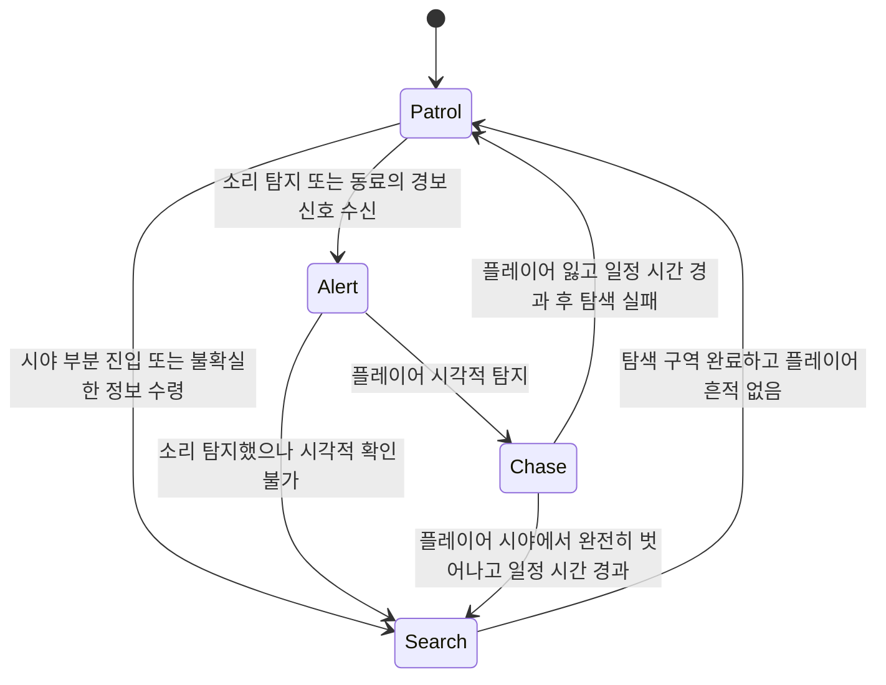

# 적 AI 시스템

| 항목 | 내용 |
|---|---|
| 문서 유형 | 시스템 기획서 |
| 상태 | Draft |
| 버전 | 0.1 |
| 최종 수정 | 2026-10-12 |
| 작성자 | 대표 (CEO) |
| 관련 이슈 | REFAA-2 |
| 관련 문서 | [GDD](../gdd/modern-military-stealth.md), [은신 시스템](./stealth-system.md), [정보 시스템](./info-system.md) |

## 1. 이 시스템이 왜 필요한가
적 AI 시스템이 없으면 플레이어는 의미 있는 도전이나 긴장감을 느낄 수 없음. 이는 게임의 핵심 필러인 "긴장감 있는 은신"과 "전략적 의사결정"을 가능하게 함. 적은 단순히 선로를 따라 움직이는 것이 아니라 플레이어의 행동에 반응하고 탐색 협력하며 기억을 가져야 함.

## 2. 전제 조건
- 의존하는 시스템: 은신 시스템 (플레이어 노출 정보 제공), 음향 시스템 (소리 기반 탐지)
- 가정: 적은 시야 원뿔과 청력 반경을 갖며, 협력하여 정보를 공유할 수 있음

## 3. 규칙
1. **상태 기반 행동**: 적은 현재 상황에 따라 다른 행동을 함
   - 입력: 플레이어 탐지 상태, 마지막 알려진 플레이어 위치, 동료들의 정보
   - 처리: 현재 상태에 따른 행동 선택 로직 실행
   - 결과: 순찰, 탐색, 추적, 경보 상태 중 하나의 행동 수행

2. **시야 기반 탐지**: 적은 앞쪽 원뿔 영역 내에서 플레이어를 시각적으로 탐지할 수 있음
   - 입력: 적의 위치 및 시야 방향, 플레이어 위치
   - 처리: 시야 각도 및 거리 내에 플레이어가 있는지 확인
   - 결과: 탐지 시 플레이어의 마지막 알려진 위치 업데이트

3. **청력 기반 탐지**: 적은 주위에서 발생하는 소리를 듣고 플레이어의 위치를 추정할 수 있음
   - 입력: 발생한 소리의 위치 및 강도, 적의 위치 및 청력 민감도
   - 처리: 소리의origine점으로부터의 방향 추정 및 강도 기반 신뢰도 계산
   - 결과: 충분히 강한 소리이면 해당 위치로 탐색 행동 전환

4. **정보 공유 시스템**: 적들은 탐지된 정보를 일정 반경 내에서 공유함
   - 입력: 한 적이 플레이어를 탐지했을 때
   - 처리: 탐지 정보를 인근 동료들에게 전달 (감쇠 함수 적용)
   - 결과: 직접 보지 못한 적들도 플레이어의 대략적인 위치 알게 됨

5. **기억 시스템**: 적들은 일정 시간 동안 플레이어의 마지막 알려진 위치를 기억함
   - 입력: 플레이어가 탐지되어 사라졌을 때
   - 처리: 마지막 알려진 위치를 기억하고 일정 시간 동안 해당 지역을 집중 탐색
   - 결과: 플레이어가 잠시 은신해도 적들이 완전히 잊지 않고 영역을 수색함

## 4. 상태와 전이

전이 조건과 가드 조건을 표로:

| 전이 | 조건 | 가드 조건 |
|---|---|---|
| Patrol → Alert | 동료의 경보 신호 수신 또는 자체 소리 탐지 (임계값 초과) | 현재 상태가 Chase가 아님 |
| Patrol → Search | 시야 원뿔 30-70% 진입 또는 소리 탐지 (낮은 신뢰도) | 마지막 알려진 위치가 유효함 |
| Alert → Chase | 시야 원뿔 100% 진입 및 식별 성공 | 총알 없음 상태가 아님 (해당 시) |
| Alert → Search | 소리 탐지했으나 시야 확인 불가 후 2초 경과 | 탐지 위치가 합리적 거리 내임 |
| Chase → Search | 플레이어 시야에서 100% 벗어나고 5초 경과 | 마지막 알려진 위치로 이동 중 |
| Search → Patrol | 탐색 반경 90% 커버리지 달성하고 새로운 흔적 없음 | 플레이어 탐지 시도 3회 이상 실패 |
| Chase → Patrol | 추적 중 플레이어 흔적 30초 연속 탐지 실패 | 안전 지역으로 후퇴 명령 수신 |

## 5. 수치
| 이름 | 기본값 | 범위 | 튜닝 담당 | 근거 |
|---|---|---|---|---|
| 시야 탐지 각도 | 90도 | 60-120도 | 대표 | militares의 넓은 시야각 고려 |
| 시야 탐지 거리 | 20m | 15-30m | 대표 | 훈련된 병사의 시야 거리 |
| 청력 탐지 기본 거리 | 15m | 10-25m | 대표 | 발소리가 전달되는 전투 거리 |
| 순찰 속도 | 2.5 m/s | 1.5-3.5 m/s | 대표 | 보병의 통상 보행 속도 |
| 탐색 속도 | 1.8 m/s | 1.0-2.5 m/s | 대표 | 주의 깊게 obszar 조사 중 속도 |
| 추적 속도 | 3.5 m/s | 2.5-4.5 m/s | 대표 | 위협에 대한 반응적 달음질 |
| 정보 전달 반경 | 25m | 15-35m | representative | 음성으로 의사소통 가능한 거리 |
| 정보 전달 감쇠 | 20%/5m | 10-30%/5m | 대표 | 거리에 따른 소리 감소 모방 |
| 기억 지속 시간 | 20초 | 10-30초 | 대표 | 단기 전투 기억 기반 |
| 탐색 구역 크기 | 10m 반경 | 5-15m 반경 | 대표 | 한 구역을 충분히 탐색할 수 있는 영역 |
| 경보 확산 지연 | 0.5초 | 0.1-1.0초 | 대표 | 신경 전달 및 처리 시간 시뮬레이션 |

수식 예시:
- 소리 신뢰도: `신뢰도 = 소리강도 * (1 - 거리/탐지거리) * 각도보정`
- 정보 전달 강도: `전달강도 = 원본강도 * (1 - 거리/전달반경 * 감쇠율)`

## 6. 엣지케이스와 실패 처리
| 상황 | 기대 동작 | 이유 |
|---|---|---|
| 동시 다중 탐지 신호 | 가장 신뢰도 높은 신호 우선 처리 | 모순된 정보 방지 |
| 플레이어가 장애물 뒤에 완전히 숨었을 때 | 마지막 알려진 위치 주변 탐색 지속 | 음향 정보는 여전히 유효할 수 있음 |
| 적끼리 너무 가까이 몰려있을 때 | 최소 거리 유지 행동 발동 | 비현실적인 클러스터링 방지 |
| 지도 가장자리 근처에서 탐색 | 지도 경계 내에서 탐색 행동을 유지 | 맵 외부로 이탈 방지 |
| 세이브/로드 중 | 모든 적의 상태 및 기억 내용 유지 | 연속성 있는 전투 경험 |
| 모든 적이 플레이어를 잃었을 때 | 순찰로 복귀 전에 짧은 경계 유지 상태 | 완전히 안전함을 확인하는 프로세스 |

## 7. Godot 구현 연결
- **노드/씬 구성**: 
  - 씬 파일 경로: `res://ai/enemy/enemy_controller.gd`
  - 루트 노드 타입: `CharacterBody2D` (2D 게임 가정을 기준으로, 실제로는 3D일 수 있음)
  - 주요 자식 노드: 
    - `RayCast2D` x4 (시야 검사용, 사방 방향으로)
    - `Area2D` (소리 탐지용)
    - `StateMachine` (행동 상태 관리용)
- **데이터**: 
  - EnemyState.resourcest 스키마:
    - `current_state: StateEnum` (Patrol, Alert, Search, Chase)
    - `last_known_player_position: Vector2`
    - `time_since_last_sighting: float`
    - `alert_level: float` (0-1)
    - `memory_positions: Array[Vector2WithTime]`
    - `patrol_route: Array[Vector2]` (순찰 경로 포인트들)
- **신호(Signal)**:
  - `enemy_state_changed(enemy_id: String, new_state: StateEnum)`: 상태 변화 시
  - `enemy_saw_player(enemy_id: String, player_position: Vector2)`: 적에게 플레이어 보냄 시
  - `enemy_heard_sound(enemy_id: String, sound_position: Vector2, strength: float)`: 적에게 소리 들림 시
  - `enemy_sharing_info(enemy_id: String, info: EnemyInfo)`: 적에게 정보 공유 시
- **입력**: 
  - 적 AI는 주로 내부 이벤트에 반응하므로 직접 InputMap 연결은 적음
  - 디버그용: `toggle_ai_debug`: D키로 AI 시야 범위 표시 토글
- **오토로드(싱글톤)**: `EnemyManager` (모든 적의 관리 및 정보 공유 조정)
- **저장 대상**: 세이브에 들어가는 필드
  - `enemies_state`: 모든 적의 현재 상태 배열
  - `shared_knowledge`: 현재 공유된 적 지식 (중복 제거됨)

## 8. 표현 요소
| 항목 | 정의할 것 |
|---|---|
| 행동·AI | 
  - State.Patrol: 규칙적인 순찰 경로 fölge
  - State.Alert: 머리 기울이고 주변 살핌 자세
  - State.Search: 낮은 자세로 구역을 천천히 살핌
  - State.Chase: 달리며 총구 조준 자세 (해당 시)
|
| 모션 | 
  - 순찰 애니메이션: 보행 루프 (1.2초)
  - 탐색 애니메이션: 숙은 자세 보행 루프 (1.5초)
  - 추적 애니메이션: 달리기 루프 (0.8초)
  - 경보 전환: 머리를 빠르게 돌리는 제스처 (0.3초)
|
| 소리 | 
  - 순찰 중: 가벼운 발소리 + occasional hand signals
  - 탐지 시: "헉!" 또는 "무엇이었어?" 같은 단성 utterance
  - 추적 중: 숨찬 숨소리 + 총장전 소리 (해당 시)
  - 탐색 실패: 실망한 한숨 + 머리가 опуска 제스처
|
| 화면 반응 | 
  - 적 시야 표시: HUD에 미니맵 형태의 원뿔 표시 (은신 시스템과 연동)
  - 탐지 효과: 적 머리 위에 느낌표 아이콘 표시
  - 경보 상태: 적 전체에 빨간색 테두리 점멸
  - 정보 공유: 적끼리 선 연결 표시 (디버그 모드에서)
|
| 에셋 요청 | 
  - 적 순찰/탐색/추적 애니메이션 세트 (각 방향별)
  - 적 시야 원뿔 메쉬 (디버그용, 반투명)
  - 음성 효과음 세트 (발견, 경보, 탐색, 추적 등)
  - 협력 신호 효과음 (손짓, 간단한 음성 명령)
  - 적 군집 방지를 위한 최소 거리 시각화 효과 (디버그용)

## 9. 성능 예산
- 프레임당 비용 목표: 1.0ms per 적 (게임 로직 10% 할당 내, 10마리 기준)
- 최대 동시 적 수: 15명 (성능 목표 달성 시)
- 메모리 상한: 15MB (상태 데이터, 경로 캐시, 기억 버퍼)

## 10. 검증 방법
어떻게 테스트하나. 수용 기준을 "~할 때 ~이 ~한다"로 3개 이상.
- 적이 플레이어를 볼 때 → 즉시 Chase 상태로 전환하고 추적을 시작함
- 적이 소리를 들었을 때 → 해당 위치로 2초 후 탐색 행동을 시작함
- 한 적이 플레이어를 발견했을 때 → 5초 이내에 인근 동료들도 Alert 상태로 전환함
- 플레이어가 완전히 숨었을 때 → 적들이 마지막 알려진 위치 주변을 체계적으로 탐색함
- 플레이어가 장시간 은신해 있을 때 → 적들이 결국 순찰로 복귀함 (기억 시간 만료)

## 11. 후속 문서 TODO
| ID | 필요한 문서/작업 | 왜 필요한가 | 담당 | 선행 조건 | 시급도 |
|---|---|---|---|---|---|
| T-11 | 적 AI 유닛 테스트 | 상태 전이 및 규칙 정확성 검증 필요 | 대표 | 시스템 기획서 완료 | 즉시 |
| T-12 | 은신 시스템과의 연동 테스트 | 적 AI가 은신 정보에 제대로 반응하는지 검증 | 대표 | 은신 시스템 기획서 완료 | 다음 마일스톤 |
| T-13 | 적 군집 방지 시스템 | 적이 너무 가까이 몰려있는 현상 방지 필요 | 대표 | 프로토타입 단계 | 다음 마일스톤 |
| T-14 | 적 시야/청력 디버그 시각화 도구 | AI 감각 범위 표시를 위한 도구 필요 | 대표 | 프로토타입 시작 전 | 즉시 |