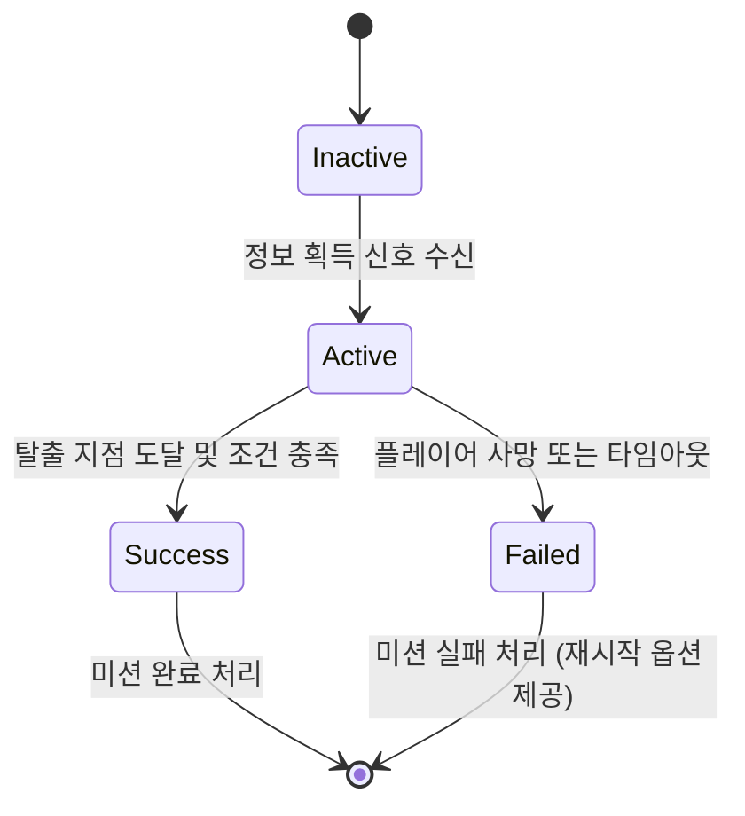

# 탈출 시스템

| 항목 | 내용 |
|---|---|
| 문서 유형 | 시스템 기획서 |
| 상태 | Draft |
| 버전 | 0.1 |
| 최종 수정 | 2026-10-12 |
| 작성자 | 대표 (CEO) |
| 관련 이슈 | REFAA-2 |
| 관련 문서 | [GDD](../gdd/modern-military-stealth.md), [은신 시스템](./stealth-system.md), [정보 시스템](./info-system.md), [적 AI 시스템](./enemy-ai.md) |

## 1. 이 시스템이 왜 필요한가
탈출 시스템이 없으면 플레이어는 정보를 획득한 후 meaningful한 목표를 잃게 됨. 이는 게임의 핵심 필러인 "탈출의 쾌감"을 가능하게 함. 플레이어는 정보를 얻은 후 적들의 추적을 피해 안전 지점까지 도달해야 함으로써 완전한 은신 루프를 경험함.

## 2. 전제 조건
- 의존하는 시스템: 
  - 정보 시스템 (목표 완료 신호 수신)
  - 은신 시스템 (추적 중 은신도 관리)
  - 적 AI 시스템 (정보 획득 후 행동 변화)
  - HUD 시스템 (탈출 목표 및 추적 상황 표시)
- 가정: 정보 획득 후 적들의 경보 수준이 상승하고 추적 행동이 시작됨

## 3. 규칙
1. **목표 전환 트리거**: 정보 획득 시 탈출 목표로 자동 전환
   - 입력: 정보 시스템으로부터의 정보 획득 신호
   - 처리: 현재 목표를 정보 획득에서 탈출로 변경
   - 결과: HUD에 새로운 목표 표시 및 내비게이션 업데이트

2. **추적 시스템 활성화**: 정보 획득 후 적들의 행동이 순찰에서 추적으로 변화
   - 입력: 정보 acquisition 완료 신호
   - 처리: 적 AI 매니저에게 추적 모드 활성화 신호 전송
   - 결과: 적들의 속도 증가, 시야/청력 범위 확대, 협력적 탐색 행동 시작

3. **탈출 조건 판단**: 플레이어가 탈출 지점에 도달했을 때 미션 성공 처리
   - 입력: 플레이어 위치 및 탈출 지점 영역
   - 처리: 거리 기반 도달 여부 판단 및 추가 조건 확인 (은신도 등)
   - 결과: 조건 충족 시 미션 성공 처리 및 보상 지급

4. **난이도 동적 조정**: 탈출 중 상황 난이도를 정보 획득 시점과 시간 등에 따라 조정
   - 입력: 정보 획득 시간, 현재 은신도, 남은 거리 등
   - 처리: 적들의 추적 강도 및 수량을 동적으로 조정
   - 결과: 정보 획득 초기에는 강한 추적, 시간 지날수록 점진적 감소 (안전지대 접근 시)

## 4. 상태와 전이

전이 조건과 가드 조건을 표로:

| 전이 | 조건 | 가드 조건 |
|---|---|---|
| Inactive → Active | 정보 시스템으로부터 정보 acquisition 완료 신호 수신 | 현재 상태가 Inactive일 때 |
| Active → Success | 플레이어가 탈출 지점 반경 내에 있고 미션 실패 조건 없음 | 성공 조건 모두 충족 시 |
| Active → Failed | 플레이어 체력 0 또는 미션 타임아웃 초과 시 | 실패 조건 발생 시 |
| Success → [*] | 미션 완료 처리 후 | 상태 유지 또는 리셋 준비 |
| Failed → [*] | 미션 실패 처리 후 | 상태 유지 또는 리셋 준비 |

## 5. 수치
| 이름 | 기본값 | 범위 | 튜닝 담당 | 근거 |
|---|---|---|---|---|
| 탈출 지점 반경 | 3.0m | 2.0-5.0m | 대표 | 합리적인 도착 판정 거리 |
| 정보 획득 후 추적 지연 | 2.0초 | 1.0-3.0초 | 대표 | 플레이어가 반응할 시간 제공 |
| 추적 속도 증가 배수 | 1.5x | 1.2-2.0x | 대표 | 적들의 대응 속도 증가 |
| 시야 범위 증가 배수 | 1.3x | 1.1-1.6x | representative | 경보 상태에서의 주의력 증가 |
| 청력 범위 증가 배수 | 1.4x | 1.2-1.8x | 대표 | 경보 상태에서의 예민도 증가 |
| 기본 추적 시간 | 60.0초 | 30.0-120.0초 | 대표 | 정보 획득 후 안전한 시간 보장 |
| 추적 감소율 | 5%/10초 | 2-10%/10초 | 대표 | 시간 지날수록 적들의 관심도 감소 |
| 성공 조건 은신도 임계값 | 40점 이하 | 20-60점 | 대표 | 완전 은신이 필요하지 않음, 적당히 숨은 상태 허용 |
| 미션 타임아웃 | 180.0초 | 120-300초 | 대표 | 3분 내외로 미션 완료 기대 |

수식 예시:
- 현재 추적 강도: `기본강도 * (1 + 속도증가배수) * max(0, 1 - (경과시간/기본추적시간) * 감소율)`
- 탈출 조건: `거리 <= 탈출지점반경 AND 은신도 <= 성공조건은신도임계값`

## 6. 엣지케이스와 실패 처리
| 상황 | 기대 동작 | 이유 |
|---|---|---|
| 정보 획득 직후 즉시 탈출 지점 도착 | 즉시 성공 처리 (보상 가능성 조정) | 효율적인 플레이에 대한 보상 |
| 탈출 중 세이브/로드 | 모든 시스템 상태 유지 후 이어서 플레이 | 연속성 있는 경험 제공 |
| 탈출 지점이 적에게 완전히 둘러싸여 있을 때 | 가능한 경로 찾기 또는 시간 기반 경로 생성 제공 | 소프트락 방지를 위한 안전망 |
| 정보 획득 후 적 모두가 즉시 사망 처리 (비현실적 시) | 정상 추적 로직 유지 | 게임 균형 및 도전감 유지 |
| 여러 탈출 지점 존재 시 | 가장 가까운 지점을 목표로 설정 또는 플레이어 선택 옵션 제공 | 유연한 플레이 경험 제공 |

## 7. Godot 구현 연결
- **노드/씬 구성**: 
  - 씬 파일 경로: `res://systems/escape/escape_manager.tscn`
  - 루트 노드 타입: `Node` (싱글톤 관리자)
  - 주요 자식 노드: 
    - `Timer`: 추적 duration 및 감소 관리용
    - `AudioStreamPlayer2D`: 추적 분위기 사운드 재생용
    - `NotificationQueue`: 탈출 관련 알림 관리용
- **데이터**: 
  - EscapeState.resourcest 스키ma:
    - `current_state: StateEnum` (Inactive, Active, Success, Failed)
    - `time_since_info_acquisition: float`
    - `escape_route_progress: float` (0-100, 탈출 지점까지의 진행도)
    - `pursuit_intensity: float` (0-1, 현재 추적 강도)
    - `active_pursuit_timers: Array[float]` (각 적별 추적 활성화 시간)
- **신호(Signal)**:
  - `escape_state_changed(new_state: StateEnum)`: 상태 변화 시
  - `info_acquired_signal_received()`: 정보 시스템으로부터 신호 수신 시
  - `pursuit_started()`: 추적 시스템 활성화 시
  - `pursuit_ended(reason: String)`: 추적 종료 시 (성공/실패/타임아웃)
  - `escape_progress_updated(progress: float)`: 탈출 진행도 변경 시
  - `mission_result(success: Boolean, score: int)`: 미션 결과 처리 시
- **입력**: 
  - 탈출 시스템은 주로 내부 신호에 반응하므로 직접 입력 연결은 적음
  - 디버그용: `force_escape_success`: F2키로 즉시 성공 처리 (디버그 전용)
- **오토로드(싱글톤)**: EscapeManager (전역에서 접근 가능)
- **저장 대상**: 세이브에 들어가는 필드
  - `escape_state`: 현재 탈출 시스템 상태
  - `mission_stats`: 미션별 통계 (최단 시간, 최고 점수 등)
  - `escape_history`: 최근 탈출 시도 기록

## 8. 표현 요소
| 항목 | 정의할 것 |
|---|---|
| 행동·AI | 
  - State.Inactive: 대기 상태, 별도 표시 없음
  - State.Active: 추적 중 표시 (HUD를 통해)
  - State.Success: 성공 애니메이션 및 효과
  - State.Failed: 실패 애니메이션 및 효과
|
| 모션 | 
  - 성공 시: 캐릭터가 안전 구역으로 달려가는 애니메이션
  - 실패 시: 캐릭터가 적에게 잡히는 애니메이션 또는 쓰러지는 애니메이션
  - 추적 중: 적이 더 빠르게 달려오는 애니메이션
|
| 소리 | 
  - 정보 획득 후: 긴장감 상승하는 음악 전환
  - 추적 중: 심장박동 소리 증가 + 적 발소리 acercándose
  - 성공 해방감: 승리 음악 + 효과음
  - 실패 긴장감: 어두운 효과음 + 심장박동 멈추는 소리
|
| 화면 반응 | 
  - 목표 표시 변경: HUD에서 "목표: 정보 획득" → "목표: 안전 지점까지 탈출"로 변경
  - 추적 강도 표시: HUD에 위험도 게이지 또는 적 수 표시
  - 탈출 진행도: 미니맵에 경로 표시 또는 거리 숫자 표시
  - 성공 효과: 화면 중앙에 큰 성공 텍스트 + 배경 축하 효과
  - 실패 효과: 화면이 어두워지며 실패 원인 표시 + 재시작 옵션
|
| 에셋 요청 | 
  - 탈출 지점 모델 세트 (헬리콥터 landing zone, 안전 집, 지하문 등)
  - 승리/실패 효과음 세트 (축하 음악, 슬픈 음악 등)
  - 추적 중 효과음 세트 (심장박동, 적 접근 소리, 긴장감 음악)
  - 성공/실패 화면 효과 세트 (화면 필터, 파티클 효과 등)
  - 미니맵 경로 표시용 아이콘 세트 (경로선, 목적지 마커 등)
  - HUD용 추가 요소 (추적 강도 게이지, 탈출 진행도 표시 등)

## 9. 성능 예산
- 프레임당 비용 목표: 0.3ms (게임 로직 3% 할당 내)
- 최대 동시 추적 적 수: 20명 (정보 acquisition 후 증가 가능)
- 메모리 상한: 8MB (상태 데이터, 타이머, 알림 큐브)

## 10. 검증 방법
어떻게 테스트하나. 수용 기준은 "~할 때 ~이 ~한다"로 3개 이상.
- 정보 획득이 완료되면 → 즉시 탈출 목표로 변경되고 HUD가 업데이트된다
- 정보 획득 후 2초 지연 후에 → 적들이 추적 행동으로 전환된다
- 플레이어가 탈출 지점에 도달하고 조건을 충족하면 → 미션 성공 처리가 된다
- 플레이어가 탈출 중 사망하거나 타임아웃되면 → 미션 실패 처리가 된다
- 정보 획득 초기에는 → 강한 추적이 이루어지지만 시간 지날수록 점진적으로 감소한다

## 11. 후속 문서 TODO
| ID | 필요한 문서/작업 | 왜 필요한가 | 담당 | 선행 조건 | 시급도 |
|---|---|---|---|---|---|
| T-27 | 탈출 시스템 유닛 테스트 | 상태 전이 및 목표 전환 정확성 검증 필요 | 대표 | 시스템 기획서 완료 | 즉시 |
| T-28 | 추적 난이도 커브 정의 | 정보 획득 시점부터 탈출까지의 난이도 프로파일 설계 필요 | 대표 | 시스템 기획서 확정 후 | 다음 마일스톤 |
| T-29 | 세계 변화 연동 시스템 | 정보 acquisition이 적 AI 및 세계에 미치는 영향 정의 필요 | 대표 | 관련 시스템 기획서 완료 | 다음 마일스톤 |
| T-30 | 성공/실패 화면 디자인 | 미션 결과 피드백을 위한 별도 화면 설계 필요 | 대표 | 기본 시스템 구현 후 | 나중 |