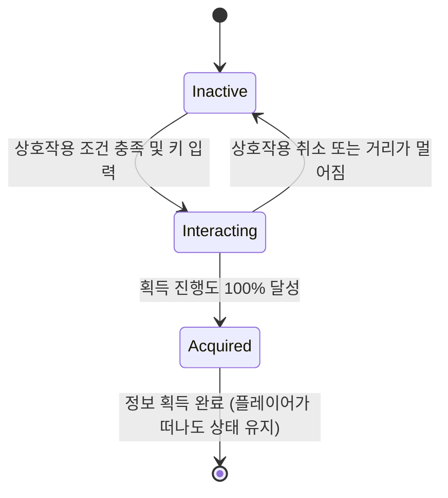

# 정보 시스템

| 항목 | 내용 |
|---|---|
| 문서 유형 | 시스템 기획서 |
| 상태 | Draft |
| 버전 | 0.1 |
| 최종 수정 | 2026-10-12 |
| 작성자 | 대표 (CEO) |
| 관련 이슈 | REFAA-2 |
| 관련 문서 | [GDD](../gdd/modern-military-stealth.md), [은신 시스템](./stealth-system.md), [탈출 시스템](./escape-system.md) |

## 1. 이 시스템이 왜 필요한가
정보 시스템이 없으면 플레이어는 목표 달성의 성취감을 느낄 수 없음. 이는 게임의 핵심 필러인 "정보 획득 쾌감"을 가능하게 함. 플레이어는 목표 객체를 찾아 상호작용하고, 정보를 얻어낸 후 탈출로 진행해야 함.

## 2. 전제 조건
- 의존하는 시스템: 은신 시스템 (접근 가능 여부 판단), HUD 시스템 (진행 상황 표시)
- 가정: 정보 객체는 특정 상호작용을 통해 활성화되며, 상호작용 후 상태 변화가 있음

## 3. 규칙
1. **상태 기반 객체**: 정보 객체는 여러 상태를 가질 수 있음
   - 입력: 플레이어 상호작용, 현재 상태
   - 처리: 상태 전이 로직에 따라 다음 상태 결정
   - 결과: 미활성화 → 상호작용 중 → 활성화(정보 획득) 중 하나의 상태

2. **상호작용 트리거**: 플레이어가 특정 조건 하에서 정보 객체와 상호작용할 수 있음
   - 입력: 플레이어 위치 및 방향, 상호작용 키 입력
   - 처리: 거리 및 각도 조건 확인 후 상호작용 시작 가능 여부 판단
   - 결과: 조건 충족 시 상호작용 시작, 실패 시 피드백 제공

3. **정보 획득 프로세스**: 상호작용 후 일정 시간 동안 정보를 획득하는 과정 진행
   - 입력: 상호작용 시작 시간
   - 처리: 획득 진행도 계산 (시간 기반 또는 미니게임 결과)
   - 결과: 진행도 100% 달성 시 정보 획득 완료 처리

4. **획득 효과**: 정보 획득 시 게임 세계에 다양한 효과 발생
   - 입력: 정보 획득 완료 시점
   - 처리: 적 행동 변경, 환경 변화, 스토리 진행 등 적용
   - 결과: 추적 난이도 증가, 탈출 경로 변경, 새로운 목표 표시 등

## 4. 상태와 전이

전이 조건과 가드 조건을 표로:

| 전이 | 조건 | 가드 조건 |
|---|---|---|
| Inactive → Interacting | 플레이어가 상호작용 범위 내에 있고 interaction 키 입력 | 객체가 현재 Inactive 상태일 때 |
| Interacting → Acquired | 획득 진행도 >= 100% | 상호작용이 지속적으로 유지될 때 |
| Acquired → [*] | 정보 acquisition 완료 후 | 상태 변경 없음 (완료 상태 유지) |
| Interacting → Inactive | 플레이어가 상호작용 범위 밖으로 이동하거나 취소 입력 | 상호작용이 중단될 때 |

## 5. 수치
| 이름 | 기본값 | 범위 | 튜닝 담당 | 근거 |
|---|---|---|---|---|
| 상호작용 거리 | 2.0m | 1.0-3.0m | 대표 | 팔 길이 정도로 합리적 거리 |
| 상호작용 각도 | 60도 | 45-90도 | representative | 정면에서 충분히 넓은 각도 |
| 획득 시간 | 5.0초 | 3.0-8.0초 | 대표 | 긴장감과 성취감 사이의 균형 |
| 획득 진행도 증가율 | 20%/초 | 10-40%/초 | 대표 | 5초 기준 목표 달성을 위한 수치 |
| 상호작용 취소 거리 | 3.0m | 2.5-4.0m | 대표 | 약간의 여유 거리 확보 |
| 상호작용 취소 각도 | 80도 | 70-100도 | 대표 | 약간 뒤돌아도 취소되지 않도록 |

수식 예시:
- 획득 진행도: `진행도 = min(100, (현재시간 - 상호작용시작시간) * 증가율)`
- 상호작용 가능 조건: `거리 <= 상호작용거리 AND 각도 <= 상호작용각도/2`

## 6. 엣지케이스와 실패 처리
| 상황 | 기대 동작 | 이유 |
|---|---|---|
| 이동 중 상호작용 시도 | 상호작용 시작 불가 + 피드백 제공 | 안정적인 상호작용을 위한 조건 |
| 상호작용 중 적에게 탐지됨 | 상호작용 계속 가능 (게이지에 영향만) | 긴장감 유지 및 전략적 선택 강요 |
| 상호작용 중 세이브/로드 | 진행도 유지 후 로드 | 연속성 있는 경험 제공 |
| 여러 플레이어가 동시에 상호작용 (멀티플레이 가정) | 첫 번째 플레이어 우선 처리 | 경쟁 조건 방지 |
| 정보 객체 파괴 가능성 | 파괴 시 정보 획득 불가 처리 | 오브젝트의 무결성 유지 필요 시 |

## 7. Godot 구현 연결
- **노드/씬 구성**: 
  - 씬 파일 경로: `res://objects/info_object/info_object.tscn`
  - 루트 노드 타입: `Area3D` (3D 상호작용 객체 기준)
  - 주요 자식 노드: 
    - `MeshInstance3D`: 객체 시각적 표현
    - `CollisionShape3D`: 상호작용 영역 정의
    - `AnimationPlayer`: 상태 변화 애니메이션 재생
    - `Sprite3D`: 상호작용 프롬프트 아이콘 표시
- **데이터**: 
  - InfoObjectState.resourcest 스키마:
    - `current_state: StateEnum` (Inactive, Interacting, Acquired)
    - `interaction_progress: float` (0-100)
    - `time_since_interaction_start: float`
    - `is_activated: bool` (획득 후 세계 변화 플래그)
- **신호(Signal)**:
  - `info_state_changed(new_state: StateEnum)`: 상태 변화 시
  - `interaction_started(player_id: String)`: 상호작용 시작 시
  - `interaction_cancelled(reason: String)`: 상호작용 취소 시
  - `info_acquired(object_id: String)`: 정보 획득 완료 시
  - `interaction_prompt_toggled(show: Boolean)`: 상호작용 프롬프트 표시 토글 시
- **입력**: 
  - `interaction`: E키 또는 패드 오른쪽 버튼 (공통 액션 사용)
- **오토로드(싱글톤)**: InfoObjectManager (모든 정보 객체의 관리)
- **저장 대상**: 세이브에 들어가는 필드
  - `info_object_states`: 모든 정보 객체의 현재 상태 배열
  - `world_changes`: 정보 acquisition으로 인한 세계 변화 목록

## 8. 표현 요소
| 항목 | 정의할 것 |
|---|---|
| 행동·AI | 
  - State.Inactive: 정지 상태, 기본 애니메이션
  - State.Interacting: 활성화 애니메이션 진행 중
  - State.Acquired: 변화된 상태 유지 (빛남 또는 개방 등)
|
| 모션 | 
  - 비활성 상태: 미미한 흔들림 또는 광원 변화
  - 상호작용 중: 활성화 진행 바 또는 에너지 충전 효과
  - 획득 완료: 빛나는 효과 또는 문 열리는 애니메이션
|
| 소리 | 
  - 상호작용 시작: 버튼 누르는 소리 또는 기기 켜지는 소리
  - 진행 중: 저음 허밍 또는 처리 중 소리
  - 획득 완료: 명확한 성공 효과음 또는 데이터 전송 소리
  - 상호작용 실패: 부정 효과음 또는 오류 알림 소리
|
| 화면 반응 | 
  - 상호작용 프롬프트: 객체 근처에 키 아이콘 표시 (HUD와 연동)
  - 획득 진행도: 원형 게이지 또는 바 형태로 표시
  - 획득 완료: 화면 중앙에 축하 효과 또는 목표 달성 알림
  - 세계 변화: 관련 객체에 시각적 변화 표시 (문 열리기, 빛 변화 등)
|
| 에셋 요청 | 
  - 정보 객체 모델 세트 (터미널, 금고, 문서 더미 등 다양한 타입)
  - 상호작용 프롬프트 아이콘 세트 (키보드, 패드 버튼 표시)
  - 진행도 표시 UI 요소 (원형 게이지, 바 게이지 세트)
  - 획득 완료 효과음 세트 (성공, 축하, 데이터 전송 등)
  - 상호작용 중 효과음 세트 (처리 중, 에너지 충전 등)
  - 세계 변화용 애니메이션 세트 (문 열리기, 조명 변화 등)

## 9. 성능 예산
- 프레임당 비용 목표: 0.2ms per 개체 (게임 로직 2% 할당 내)
- 최대 동시 정보 객체 수: 10개 (일반적으로 적음)
- 메모리 상한: 5MB (상태 데이터 및 애니메이션 캐시)

## 10. 검증 방법
어떻게 테스트하나. 수용 기준을 "~할 때 ~이 ~한다"로 3개 이상.
- 플레이어가 상호작용 범위 안에 있고 키를 누를 때 → 상호작용이 시작된다
- 상호작용 시작 후 5초가 지나면 → 정보 획득 완료 처리가 된다
- 정보 획득이 완료되면 → 관련된 세계 변화가 발생한다 (예: 문이 열리거나 적이 경보 상태가 된다)
- 상호작용 중 플레이어가 범위를 벗어나면 → 상호작용이 취소되고 초기 상태로 돌아온다
- 정보 획득 완료 후에도 → 객체는 획득 상태를 유지한다

## 11. 후속 문서 TODO
| ID | 필요한 문서/작업 | 왜 필요한가 | 담당 | 선행 조건 | 시급도 |
|---|---|---|---|---|---|
| T-24 | 정보 객체 유닛 테스트 | 상태 전이 및 획득 규칙 정확성 검증 필요 | 대표 | 시스템 기획서 완료 | 즉시 |
| T-25 | 정보 객체 풀 세트 생성 | 다양한 타입의 정보 객체 모델 제작 필요 | 대표 | 시스템 기획서 확정 후 | 다음 마일스톤 |
| T-26 | 세계 변화 시스템 연동 | 정보 획득이 게임 세계에 미치는 영향 정의 필요 | 대표 | 관련 시스템 기획서 완료 | 다음 마일스톤 |