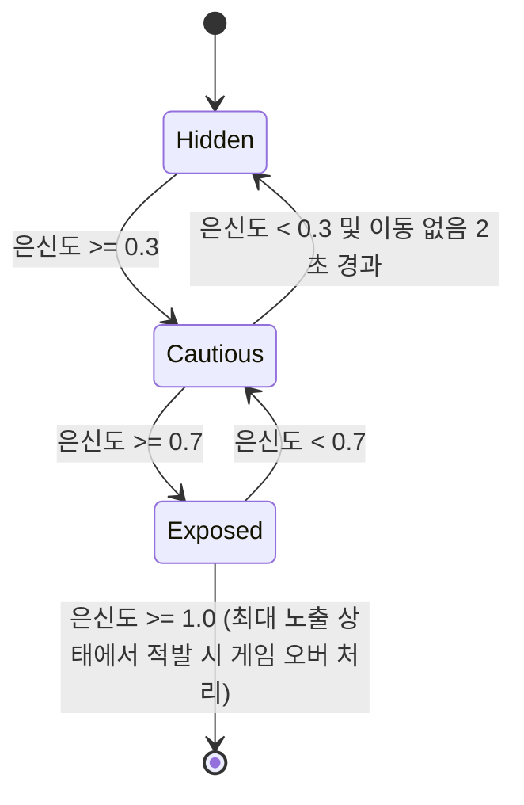

# 은신도 시스템 - 시스템 기획서

| 항목 | 내용 |
|---|---|
| 문서 유형 | 시스템 기획서 |
| 상태 | Draft |
| 버전 | 0.1 |
| 최종 수정 | 2026-10-12 |
| 작성자 | 크리에이티브 디렉터 |
| 관련 이슈 | REFAA-5 |
| 관련 문서 | [GDD](../gdd/modern-military-stealth.md) |

## 1. 이 시스템이 왜 필요한가
은신도 시스템은 플레이어의 노출 수준을 직관적으로 보여 주어 긴장감 조절 필러를 구현한다. 이 시스템이 없으면 플레이어는 자신의 위험 수준을 추측해야 하며, 긴장감과 전술적 계획이 어려워진다. GDD의 필러 정합성 표에서 "긴장감 조절" 필러와 직접 연결된다.

## 2. 전제 조건
- UI 시스템: 은신도 게이지를 표시할 수 있는 UI 요소가 존재 (UI/UX 기획서 참조)
- 저장 시스템: 은신도 값이 세이브에 저장되어야 함
- 입력 시스템: 은신도 변화에 영향을 주는 입력 (이동, 행동 등)이 정의됨

## 3. 규칙
1. 은신도 값은 0.0 (완전히 숨김) 에서 1.0 (완전히 노출) 사이의 실수이다.
2. 은신도가 0.3 이하이면 안전 구역으로 간주되어 적의 탐지 범위가 감소하지 않는다.
3. 은신도가 0.3 초과이면 적의 기본 탐지 범위에 은신도 계수를 곱하여 실효 탐지 범위를 계산한다.
4. 은신도는 시간에 따라 자연스럽게 감소하며, 은신 중 (은신도 0.3 이하 및 이동 없음) 은신도 회복이 발생한다.
5. 특정 행동 (달리기, 총소리, 충돌 등)은 은신도를 즉시 증가시킨다.
6. 은신도 값은 0.0보다 작아질 수 없으며, 1.0을 초과할 수 없다.

## 4. 상태와 전이

전이 조건과 가드 조건을 표로:

| 전이 | 조건 | 가드 조건 |
|---|---|---|
| Hidden → Cautious | 은신도 >= 0.3 | - |
| Cautious → Hidden | 은신도 < 0.3 | 이동 없음 2초 경과 |
| Cautious → Exposed | 은신도 >= 0.7 | - |
| Exposed → Cautious | 은신도 < 0.7 | - |
| Exposed → [*] (게임 오버) | 은신도 >= 1.0 | 적의 시야 내에 있음 |

## 5. 수치
| 이름 | 기본값 | 범위 | 튜닝 담당 | 근거 |
|---|---|---|---|---|
| 은신도 감소 속도 (이동 중) | 0.05/s | 0.01-0.1/s | 시스템 디자이너 | 일반적인 걷기 속도에서 노출 증가 경험 기반 |
| 은신도 증가 속도 (은신 중) | 0.02/s | 0.005-0.05/s | 시스템 디자이너 | 숨었을 때 회복되는 느낌을 주기 위해 낮게 설정 |
| 은신도 증가 (달리기) | 0.3 | 0.1-0.5 | 시스템 디자이너 | 달리기의 높은 노출감 반영 |
| 은신도 증가 (총소리) | 0.4 | 0.2-0.6 | 시스템 디자이너 | 총성은 큰 위험 요인 |
| 은신도 증가 (충돌) | 0.2 | 0.1-0.3 | 시스템 디자이ner | 가벼운 충돌도 주의를 끌 수 있음 |
| 은신도 임계값 (안전) | 0.3 | 0.2-0.4 | 시스템 디자이너 | 탐지 범위 변화 시작점 |
| 은신도 임계값 (위험) | 0.7 | 0.6-0.8 | 시스템 디자이너 | 적의 반응 속도 상승 시작점 |
| 최대 은신도 | 1.0 | 1.0 (고정) | 시스템 디자이너 | 게임 오버 조건 |

수식 예시:
- 은신도 변경량 = (기본 감소 속도 * 이동 속도 계수) + (행동별 증가량)
- 이동 속도 계수: 정지 0.0, 걷기 1.0, 달리기 2.0
- 은신도 회복 조건: 은신도 < 0.3 && 이동 속도 계수 == 0.0 && 경과 시간 >= 2.0s

## 6. 엣지케이스와 실패 처리
| 상황 | 기대 동작 | 이유 |
|---|---|---|
| 동시 입력 (예: 달리기 및 총소리) | 은신도 증가량 합산 | 여러 위험 요인이 동시에 발생하면 노출도 증가 |
| 중도 취소 (행동 중 인터럽트) | 행동 시작 시 증가량 적용, 취소 시 추가 증가 없음 | 행동의 의도가 이미 반영되었기 때문 |
| 세이브/로드 중 | 세이브 시 현재 은신도 저장, 로드 시 저장값으로 복원 | 은신도 상태는 게임의 중요한 상태이므로 유지해야 함 |
| 데이터 누락 (초기화 오류) | 은신도 값을 0.0으로 초기화 | 안전한 시작 상태를 보장 |
| 최대/최소값 초과 | 최소값 0.0, 최대값 1.0으로 클램프 | 유효 범위 밖의 값은 허용하지 않음 |

## 7. Godot 구현 연결
- 노드/씬 구성: 
  - 씬 파일 경로: `res://systems/stealth/stealth_system.tscn`
  - 루트 노드 타입: Node
  - 주요 자식 노드: 
    - StealthGauge (TextureProgressBar) - UI에 연결되어 은신도 표시
    - StealthManager (Node) - 로직 처리 스크립트 첨부
- 데이터: 
  - Resource 스키마: `res://systems/stealth/stealth_state.tres`
    - 필드: `stealth_level` (float, range 0.0-1.0)
- 신호(Signal): 
  - `stealth_changed(new_level: float)`: 은신도 값 변경 시 발출
  - `stealth_state_changed(new_state: String)`: Hidden/Cautious/Exposed 상태 변경 시 발출
  - `detected()`: 은신도 >= 1.0 및 적 시야 내 시 발출 (게임 오버 트리거)
- 입력: 
  - InputMap 액션 이름: 
    - `move_walk` (WASD 또는 좌측 스틱)
    - `move_run` (Shift 또는 RT + 방향)
    - `fire` (좌클릭 또는 RT)
    - `reload` (R 또는 D-pad下)
    - `interact` (E 또는 X 버튼)
- 오토로드(싱글톤): 
  - 이름: `StealthManager`
  - 책임: 전역 은신도 상태 관리 및 신호 발신
- 저장 대상: 
  - 세이브에 들어가는 필드: `stealth_level`

## 8. 표현 요소
- 행동·AI: 
  - 은신도 변화에 따라 적의 행동이 변화 (탐지 범위, 반응 속도)
- 모션: 
  - 은신도 게이지 애니메이션: 값 변경 시 0.2s 동안 부드러운 transición (UI/UX 기획서 참조)
- 소리: 
  - 은신도 증가 시 심장박동 소리 크기 증가 (선택적)
  - 은신도 회복 시 안정적인 소리
- 화면 반응: 
  - 은신도 게이지 색상 변화 (0-30% 녹색, 31-70% 노랑, 71-100% 빨강)
  - 은신도 >= 0.8 시 화면 가장자리 적색 점멸 (선택적)
- 에셋 요청: 
  - UI 요소: 은신도 게이지 이미지 (프로그레스 바)
  - 사운드 효과: 심장박동 소리, 회복 소리

## 9. 성능 예산
- 프레임당 비용 목표: 0.5ms (최대 60 FPS에서 30ms 예산의 1.6%)
- 최대 동시 인스턴스: 1 (싱글톤)
- 메모리 상한: 10KB (실수 변수 및 최소한의 상태)

## 10. 검증 방법
- 은신도 값이 0.0-1.0 범위 내에 머무르는가: 경계값 테스트 (0.0, 0.3, 0.7, 1.0)에서 증가/감소 로직 확인
- 은신도 회복이 올바르게 작동하는가: 은신도 < 0.3 상태에서 이동 없음 2초 경과 시 증가 시작 확인
- 행동별 은신도 증가량이 적용되는가: 각 행동 (달리기, 총소리, 충돌) 실행 시 기대 증가량 적용 확인
- 신호가 올바르게 발신되는가: 은신도 변화 시 `stealth_changed` 신호 발신, 상태 변경 시 `stealth_state_changed` 신호 발신
- 세이브/로드 후 은신도 값 유지: 세이브 후 게임 종료 및 재시작 시 이전 은신도 값 복원 확인

## 11. 후속 문서 TODO
| ID | 필요한 문서/작업 | 왜 필요한가 | 담당 | 선행 조건 | 시급도 |
|---|---|---|---|---|---|
| T-01 | 탐지 시스템 기획서 | 은신도 시스템과의 연동 필요 | 시스템 디자이너 | 은신도 시스템 기획서 완료 | 즉시 |
| T-02 | UI/UX 구현 가이드 | 은신도 게이지 구현 세부사항 | UI/UX 디자이너 | 은신도 시스템 기획서 완료 | 즉시 |
| T-03 | 사운드 디자인 계획 | 은신도 변화에 따른 피드백 사운드 | 오디오 디자이너 | 은신도 시스템 기획서 완료 | 다음 마일스톤 |