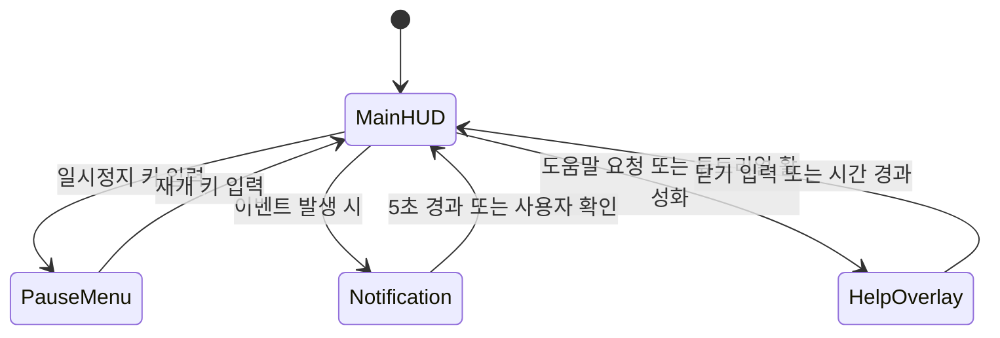

# Main HUD

| 항목 | 내용 |
|---|---|
| 문서 유형 | UI/UX 기획서 |
| 상태 | Draft |
| 버전 | 0.1 |
| 최종 수정 | 2026-10-12 |
| 작성자 | 대표 (CEO) |
| 관련 이슈 | REFAA-2 |
| 관련 문서 | [GDD](../gdd/modern-military-stealth.md), [은신 시스템](./stealth-system.md), [적 AI 시스템](./enemy-ai.md), [레벨 디자인](../levels/first-mission.md) |

## 1. 이 화면이 왜 필요한가
메인 HUD는 플레이어에게 은신 상태, 적 위치 정보, 목표 진행 상황 등을 실시간으로 제공해야 함. 이는 게임의 핵심 필러인 "긴장감 있는 은신"과 "전략적 의사결정"을 가능하게 함. 플레이어는 지속적인 피드백을 통해 자신의 행동을 조정하고 전략을 세워야 함.

## 2. 전제 조건
- 기준 해상도: 1920x1080
- 종횡비 범위: 16:9, 16:10, 21:9 지원
- 입력 장치: 키보드/마우스 (기본), 게임패드 지원
- 가정: Godot의 Control 노드 시스템을 사용하며, 앵커 기반 레이아웃 채택

## 3. 정보 구조
화면에 놓일 정보의 우선순위. 항상 보임 / 필요할 때 / 숨김.

| 정보 | 우선순위 | 표시 조건 | 갱신 주기 |
|---|---|---|---|
| 은신도 게이지 | 높음 (항상 보임) | 항상 | 매 프레임 |
| 미니맵 (적 시야 표시) | 높음 (항상 보임) | 항상 | 0.5초 간격 |
| 현재 목표 표시 | 높음 (항상 보임) | 항상 | 목표 변경 시 |
| 경고 표시 (탐지 임박) | 높음 (조건부 보임) | 은신도 80% 초과 시 | 매 프레임 |
| 상호작용 프롬프트 | 중간 (조건부 보임) | 상호작용 가능한 객체 근접 시 | 매 프레임 |
| 알림 로그 | 낮음 (일시적 보임) | 이벤트 발생 시 | 5초 후 페이드 |
| 조작 도움말 | 낮음 (옵션 보임) | 설정에서 활성화 시 또는 튜토리얼 중 | 변경 시 |

## 4. 화면 구성
와이어프레임 이미지(축척 대신 앵커 영역 표기). 영역 표.

| 영역 | 앵커/컨테이너 | 크기 규칙 | 내용 |
|---|---|---|---|
| 은신도 게이지 | 좌측 중앙 | 고정 크기 80x80px | 원형 게이지 (은신도 0-100%) |
| 미니맵 | 우측 상단 | 고정 크기 200x200px | 레벨 축소판 + 적 시야 원뿔 표시 |
| 목표 표시 | 상단 중앙 | 동적 너비 | 텍스트: "목표: 정보 획득" 또는 "목표: 탈출지점 도달" |
| 경고 표시 | 화면 전체 가장자리 | 풀스크린 이펙트 | 가장자리 빨간색 점멸 (은신도 위험 시) |
| 상호작용 프롬프트 | 하단 중앙 | 동적 크기 | 텍스트: "E키로 상호작용" 또는 "패드 A버튼으로 상호작용" |
| 알림 로그 | 좌측 하단 | 동적 크기 (최대 3줄) | 최근 이벤트 텍스트 표시 |
| 조작 도움말 | 우측 하단 | 고정 크기 250x60px | 컨트롤러 이미지 또는 키보드 키 표시 |

절대 픽셀 좌표를 박지 않는다. 앵커와 컨테이너 규칙으로 쓴다.

## 5. 상태와 전환
Mermaid stateDiagram. 화면 열기/닫기 조건, 중첩 규칙(팝업 위 팝업).

## 6. 입력
| 액션(InputMap) | 키보드 | 패드 | 동작 | 포커스 규칙 |
|---|---|---|---|---|
| ui_accept | Enter 또는 Space | A버튼 | 기본 선택/확인 | 현재 포커스된 요소 활성화 |
| ui_cancel | Esc | B버튼 | 백스/취소 | 이전 메뉴로 돌아가기 |
| ui_up | 위쪽 화살표 | 왼쪽 스틱 위 | 위로 이동 | 포커스 이동 (상) |
| ui_down | 아래쪽 화살표 | 왼쪽 스틱 아래 | 아래로 이동 | 포커스 이동 (하) |
| ui_left | 왼쪽 화살표 | 왼쪽 스틱 왼쪽으로 | 왼쪽으로 이동 | 포커스 이동 (좌) |
| ui_right | 오른쪽 화살표 | 오른쪽 스틱 오른쪽으로 | 오른쪽으로 이동 | 포커스 이동 (우) |
| interaction | E키 | 패드 오른쪽 버튼 | 상호작용 | 근접한 상호작용 객체 실행 |
| toggle_stealth_debug | F1키 | 패드 왼쪽 트리거 + right | 은신도 디버그 토글 | 디버그 모드 전환 |
| toggle_map | M키 | 패드 왼쪽 버튼 | 미니맵 확대/축소 | 미니맵 크기 변경 |
| pause | Esc | 패드 시작 버튼 | 일시정지 메뉴 | pause_menu 씬 로드 |

포커스 이동 순서: 시계 방향 (은신도 게이지 → 목표 표시 → 상호작용 프롬프트 (활성 시) → 알림 로그 → 조작 도움말 → 반복)
취소/뒤로 동작: B키 또는 Esc로 현재 활성화된 팝업/메뉴 닫기
길게 누르기 피드백: 2초 이상 길게 누를 때 지속적 행동 트리거 피드백 (예: sprint 유지)

## 7. 피드백
| 상태 | 효과음 | 애니메이션 길이(초) |
|---|---|---|
| 은신도 정상 (0-30%) | 없음 | 게이지 부드러운 움직임 |
| 은신도 주의 (31-70%) | 저음 비프음 (간헐적) | 게이지 노란색으로 변화 |
| 은신도 위험 (71-100%) | 높은 비프음 (빈번함) | 게이지 빨간색 점멸 + 화면 가장자리 효과 |
| 탐지됨 | 급격한 경보음 + 효과음 | 화면 흰색 플래시 + 효과음 |
| 상호작용 가능 | 부드러운 챔 소리 | 프롬프트 텍스트 pulsate (1.0초 사이클) |
| 상호작용 성공 | 명확한 효과음 | 객체 활성화 애니메이션 |
| 목표 달성 | 승리 팬파이어 효과음 | 화면 확대 효과 + 축하 애니메이션 |

## 8. 텍스트와 로컬라이즈
| 항목 | 내용 |
|---|---|
| 문구 키 | 
  - `hud.stealth.normal`: "은신 상태 양호"
  - `hud.stealth.warning`: "주의: 탐지 위험 증가"
  - `hud.stealth.danger`: "위험: 곧 탐지됨!"
  - `hud.objective.infiltrate`: "목표: 건물 내부로 잠입"
  - `hud.objective.gather_info`: "목표: 정보 획득"
  - `hud.objective.escape`: "목표: 안전 지점까지 탈출"
  - `hud.interact_prompt`: "{키}로 상호작용"
  - `hud.notification.objective_complete`: "목표 완료!"
  - `hud.notification.enemy_spotted`: "적 발견됨!"
|
| 최대 글자 수 | 
  - 목표 표시: 30자
  - 은신도 상태 텍스트: 20자
  - 알림 로그: 40자
  - 상호작용 프롬프트: 25자
|
| 줄바꿈 규칙 | 단어 기준으로 줄바꿈, hyphenation 없음 |
| 숫자 형식 | 
  - 은신도: 정수 표시 (0-100)
  - 시간: mm:ss 형식
  - 점수: 정수, 천 단위 콤마 표시

## 9. 접근성
| 항목 | 정의할 것 |
|---|---|
| 색 외 구분 수단 | 
  - 은신도 게이지: 색 외에도 게이지 두께 변화 (얇은→두꺼운)
  - 경고 표시: 색 외에도 화면 진동 옵션
  - 목표 표시: 색 외에도 아이콘 변경 (→ → → → → 순환)
|
| 최소 글자 크기 | 14pt (1920x1080 기준, 해상도에 따라 스케일링) |
| 자막 옵션 | 모든 효과음에 텍스트 equivalent 제공 (선택적) |
| 입력 리매핑 | 모든 InputMap 액션에 대한 완전한 리매핑 지원 |
| 시간 제한 완화 | 알림 로그 표시 시간 조정 가능 (기본 5초, 3-10초 범위) |

## 10. Godot 구현 연결
- **씬 경로**: `res://ui/main_hud/main_hud.tscn`
- **루트 `Control`**: `CanvasLayer` (화면 최상단 레이어)
- **사용할 컨테이너/위젯**: 
  - `MarginContainer`: 각 영역 간 여백 조절용
  - `VBoxContainer` / `HBoxContainer`: 요소의 수직/수평 배치용
  - `TextureProgressBar`: 은신도 게이지용 (원형 맞춤 필요)
  - `TextureRect`: 미니맵 및 아이콘 표시용
  - `Label`: 텍스트 표시용
  - `AnimationTexture`: 애니메이션이 필요한 UI 요소용
  - `ColorRect`: 경고 표시용 색 변경 영역
- **`Theme` 리소스 경로**: `res://ui/theme/default_hud.tres`
- **시그널 이름**: 
  - `stealth_level_changed(new_level: float)`: 은신도 변경 시
  - `objective_updated(new_objective: String)`: 목표 변경 시
  - `enemy_detected_on_minimap(enemy_id: String, position: Vector2)`: 미니맵에 적 표시 시
  - `interaction_prompt_shown(show: Boolean, action_name: String)`: 상호작용 프롬프트 표시 시
  - `notification_added(message: String, duration: float)`: 알림 로그 추가 시
  - `help_toggled(show: Boolean)`: 도움말 표시 토글 시

## 11. 후속 문서 TODO
| ID | 필요한 문서/작업 | 왜 필요한가 | 담당 | 선행 조건 | 시급도 |
|---|---|---|---|---|---|
| T-19 | HUD 유닛 테스트 | 각 UI 요소의 정확한 동작 검증 필요 | 대표 | UI 기획서 완료 | 즉시 |
| T-20 | HUD 디버그 시각화 도구 | 개발 중 UI 요소 위치 및 크기 조정 도구 필요 | 대표 | 프로토타입 시작 전 | 즉시 |
| T-21 | 로컬라이제이션 파일 생성 | 다국어 지원을 위한 텍스트 파일 생성 필요 | 대표 | UI 텍스트 확정 후 | 다음 마일스톤 |
| T-22 | 접근성 옵션 메뉴 | 접근성 설정 조정을 위한 별도 메뉴 필요 | 대표 | 기본 UI 구현 후 | 나중 |
| T-23 | 반응형 디자인 테스트 | 다양한 해상도 및 종횡비에서 UI 정상 동작 검증 필요 | 대표 | 프로토타입 단계 | 나중 |