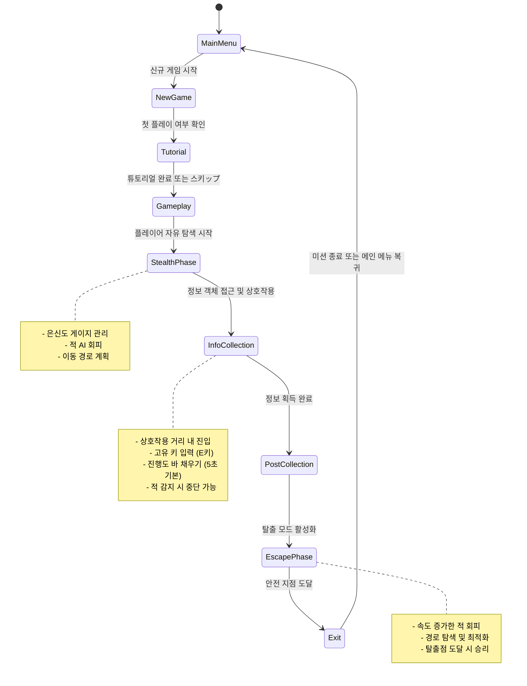
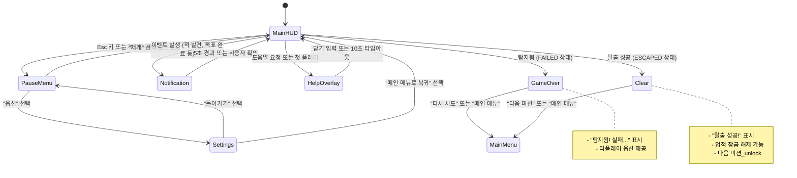
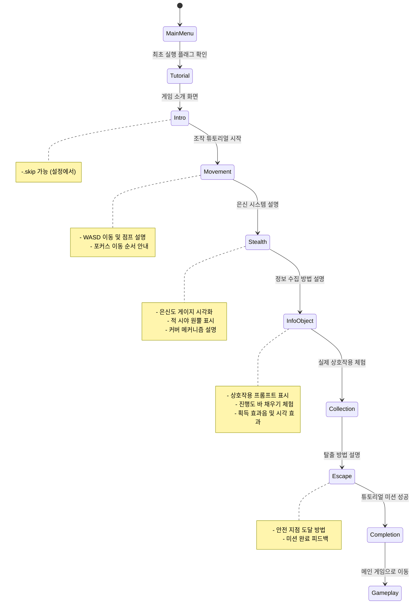
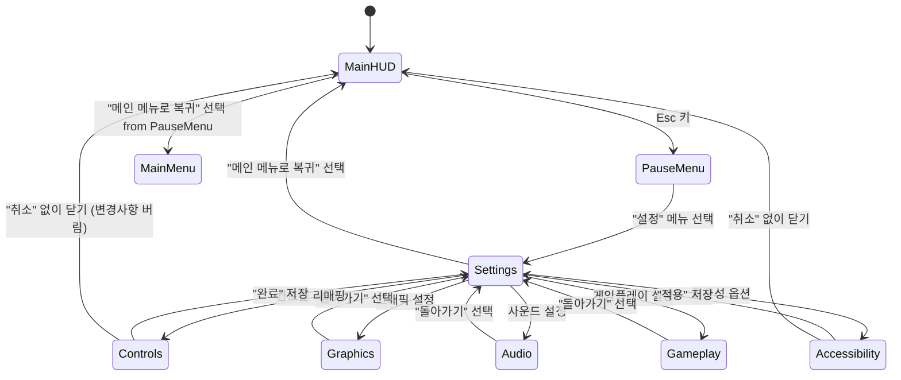
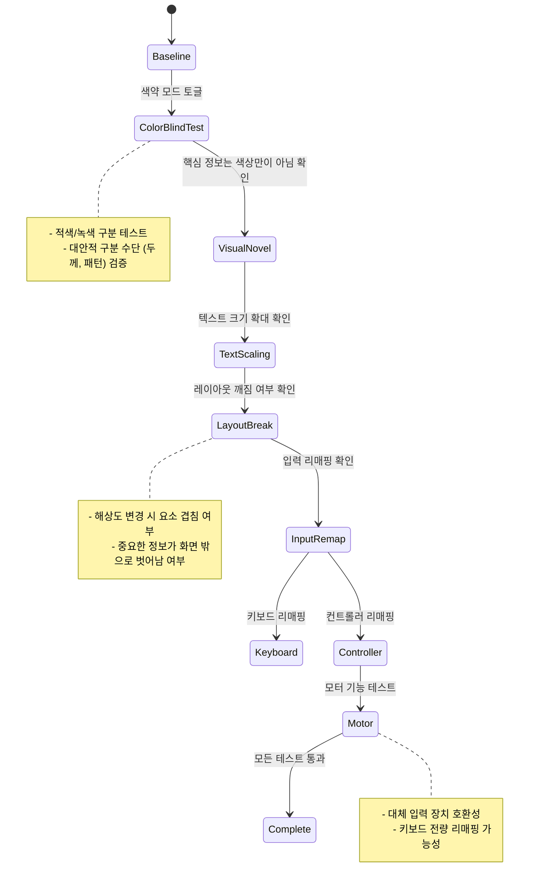

# User Flow Diagrams

## Core Loop Flow: Stealth → Info Collection → Escape



## Screen Transition Flow



## Interaction Flow: Player → Object → System

```mermaid
sequenceDiagram
    participant Player
    participant HUD
    participant GameWorld
    participant AI
    
    Player->>HUD: 접근 시 상호작용 프롬프트 표시
    HUD->>Player: "E키로 상호작용" 텍스트 표시
    Player->>HUD: E키 입력 (유지)
    HUD->>GameWorld: 상호작용 시작 신호
    GameWorld->>AI: 거리 및 각도 조건 확인
    AI-->>GameWorld: 조건 충족 여부 판단
    alt 조건 충족
        GameWorld->>GameWorld: 획득 진행도 증가 (시간 기반)
        GameWorld-->>HUD: 진행도 업데이트
        alt 진행도 100% 달성
            GameWorld->>HUD: 정보 획득 완료 알림
            HUD->>Player: "목표: 탈출지점 도달" 표시
            GameWorld->>AI: 적 행동 상태 변경 (경보 레벨 상승)
        alt 플레이어가 범위 외 이동
            GameWorld->>GameWorld: 상호작용 취소
            HUD->>Player: 프롬프트 숨기기
        alt 적에게 탐지됨
            GameWorld->>AI: 탐지 상태 전환
            AI-->>HUD: 위험 수준 업데이트
            HUD->>AlertFlash: 화면 가장자리 플래시 트리거
        end
    else 조건 불충족
        HUD->>Player: "조건이 만족되지 않음" 피드백 (간헐적)
    end
```

## Onboarding Flow: New Player Experience



## Settings Menu Flow



## Accessibility Validation Flow

